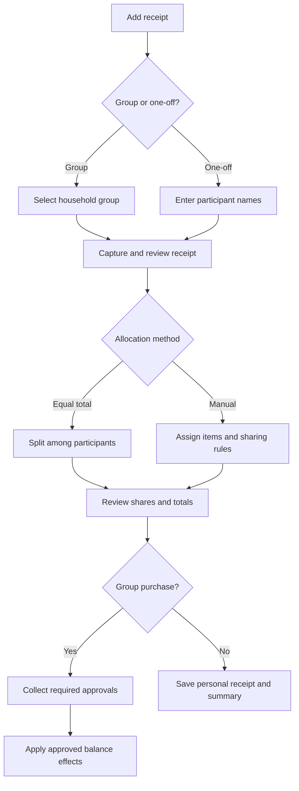
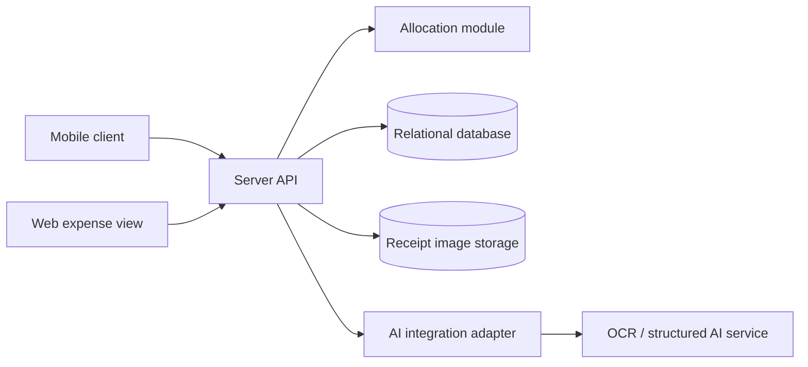

# Receipt-based Shared Expense Allocation Application

## 1. Actors and permissions
| Role | Needs | Responsibility / access |
| --- | --- | --- |
| Registered user | Record purchases and track personal expenses | Manages their account, creates groups, joins by invitation code, and records one-off purchases. |
| Group creator | Establish a household group | Creates the group and renews its invitation code. |
| Group member | Understand shared expenses and balances | Views all group receipt details, approves purchases they participate in, proposes corrections, and records repayments. |
| Receipt owner / payer | Record and allocate a purchase they paid for | Uploads the receipt, edits its initial draft, allocates shares, reviews correction proposals, and submits receipt versions for approval. |
| Payment recipient | Verify a recorded repayment | Confirms or rejects an incoming payment record. |
| One-off participant | Have their share calculated without an account | Is represented by a name on one receipt; has no login, approval rights, or account-linked balance. |

These roles can overlap. Each receipt has one payer in the initial version. Former group members retain access to their outstanding balances and repayment workflow but cannot be selected for new purchases.

## 2. Use cases / user stories
### Record and approve a group purchase
- **Actor:** Receipt owner / payer and participating group members.
- **Precondition:** The payer belongs to a household group.
- **Main flow:**
  1. Select the group and photograph or upload a receipt.
  2. Review the extracted draft and correct items, quantities, prices, and discounts.
  3. Split the total equally or allocate items manually, including quantities and sharing rules. Unassigned items can be shared in one action.
  4. Check totals and submit the receipt for participant approval.
  5. Apply balance changes once the payer and everyone with a share approve the same version.
- **Alternative / error flows:** AI failure permits manual entry. Uncertain fields, incomplete allocations, and total mismatches require review. Missing approvals keep the receipt pending. Members can propose corrections for the owner's acceptance; accepted edits require renewed approvals.
- **Postcondition:** The purchase and history are saved. For an updated approved receipt, only the allocation difference is applied after renewed approval.

### Record a repayment
- **Actor:** Debtor and payment recipient.
- **Precondition:** An outstanding group balance exists between the users.
- **Main flow:** The debtor records a partial or full payment made outside the application. The recipient confirms receipt, and the debt is reduced.
- **Alternative / error flows:** Pending, rejected, or cancelled payments have no effect; repeated confirmation cannot apply the same payment twice.
- **Postcondition:** Both users see the updated net balance and payment history.

### Split a one-off purchase
- **Actor:** Registered user.
- **Precondition:** The user has paid for a supported purchase.
- **Main flow:** Upload and correct the receipt, enter participant names including the user's own entry, allocate shares, and save the summary.
- **Postcondition:** The user can reopen the receipt, show shares to friends, and track their own expense. No participant approval or group debt is created.

## 3. Functional requirements
| Requirement | Acceptance criteria | Priority |
| --- | --- | --- |
| Users have individual accounts and group membership. | Given a valid invitation code, when a signed-in user confirms joining, then the group appears in their account. Renewed codes invalidate the previous code. | Must |
| Extract editable receipt data with AI assistance. | Given a supported image, processing suggests item names, quantities, and amounts linked to image regions; uncertain or missing fields are flagged for review. | Must |
| Permit correction and manual entry. | Given an extracted draft or an unavailable AI service, the user can add, edit, and remove draft items without losing the uploaded receipt. | Must |
| Support equal-total and manual allocation. | A 12,000 HUF equal split among three people produces 4,000 HUF each without item assignment; manual mode supports selected participants and equal, percentage, or fixed-amount shares. | Must |
| Distribute quantities and remaining items. | Three identical units can be assigned one to one person and two to another. Sharing remaining items affects only unassigned items. | Must |
| Validate amounts, discounts, and rounding. | Known-result examples preserve the final receipt total; invalid percentages, incomplete fixed shares, and unresolved total mismatches prevent submission. | Must |
| Require group approval before balance updates. | Until the payer and every participant with a share approve the same version, no new balance effect is applied. Members with no share need not approve. | Must |
| Support corrections and version history. | Accepted changes require renewed approvals; approval of a replacement applies only the allocation difference and retains prior versions. | Must |
| Show group debts and receivables. | A debt of 2,000 HUF, confirmed repayment of 1,000, new debt of 3,000, and opposite debt of 2,000 produce a net debt of 2,000 HUF. | Must |
| Confirm manually recorded repayments. | A pending payment leaves balances unchanged; recipient confirmation applies it exactly once. | Must |
| Support full and partial refunds. | An approved refund adjusts affected shares according to the original allocation and remains linked to the receipt. | Must |
| Save one-off purchases. | A saved receipt can be reopened with participant names and calculated shares, without account-linked debts for those participants. | Must |
| Warn about potential duplicates. | A matching or similar date/time and supporting receipt fields produce a warning; the user can open the existing record or confirm a different purchase. | Must |
| Export summaries. | The user can export an expense and allocation summary whose amounts match the displayed record. The format remains to be selected. | Must |
| Preserve membership history. | A new member receives no previous debt; a departed member is unavailable for new purchases but retains outstanding balance and repayment access. | Must |
| Show personal expense history. | A user can view their receipt archive, own net shares, and monthly expense total; repayments do not count as additional spending and refunds reduce net spending. | Should |

Priority: **Must** = required for the agreed core product; **Should** = important supporting functionality; **Could** = optional if time permits. The monthly overview is planned but secondary to reliable receipt allocation and balances.

## 4. Business rules and constraints
| Rule or constraint | Rationale |
| --- | --- |
| The initial receipt scope is readable printed supermarket receipts from Hungary in HUF. | Keeps extraction and evaluation manageable. Restaurant receipts, invoices, and handwritten documents are excluded initially. |
| The payer owns the receipt; other members submit proposals rather than overwrite it. | Establishes responsibility and preserves a reviewable history. |
| Equal allocation divides by participant count; percentage shares must total 100%; fixed allocations must cover the allocated amount exactly. | Prevents incomplete or excessive allocation. |
| Allocation determines responsibility; a payment records money actually received. | A promised payment never reduces a debt. |
| Item discounts reduce the associated item amount. General discounts are proportional to shares after item discounts. | Avoids double discounting and distributes savings consistently. |
| Exact decimals or integer minor units are used; rounded shares must sum to the final total. | Prevents monetary drift. The specific remainder tie-break rule is an open design detail. |
| Required approvals refer to a specific version. Accepted edits invalidate earlier approvals for the new version. | Prevents approval of unseen changes. |
| Expenses, payments, and refunds are stored as traceable movements, with group balances derived from their approved effects. | Supports partial repayments, opposite debts, and later corrections. |
| Pairwise balances are netted within each group. | The same people may belong to several groups whose balances must stay separate. |
| Refund money is assumed to return to the original payer. Refunds cannot exceed the remaining refundable quantity or amount. | Defines an initial boundary and prevents repeated refunds exceeding the purchase. |
| One-off purchases have no member approvals or persistent participant debt accounts. | Named participants are not registered identities. |
| Group approval and one-off purchase records are included in the proposed MVP. QR invitations, offline entry, multiple currencies, bank integration, and transfers are excluded. | Keeps agreed additions and later extensions explicit. |

## 5. User interface and workflow
Main navigation contains **Home**, **Groups**, **Debts**, and **My Receipts**, with a prominent **Add receipt** action. Home highlights pending reviews and payment confirmations. Receipt details show the image, editable draft or approved data, allocation, approval status, and history. The Debts view separates amounts owed from receivables and opens a person's transaction history. Personal history shows the user's own share rather than the whole amount they initially paid.

Wireframes for receipt correction, allocation, approval, and balances remain to be prepared. This flow diagram is an initial workflow representation, not a completed screen prototype.

## 6. Non-functional requirements
| Requirement | How it will be verified |
| --- | --- |
| Calculations conserve amounts exactly across allocations, discounts, refunds, and repeated operations. | Independent known-result tests, including rounding remainders and partial repayments. |
| Concurrent edits and repeated approval cannot overwrite newer versions or duplicate financial effects. | Integration tests with competing versions and repeated requests. |
| AI failure does not remove saved data or prevent manual correction and entry. | Simulated timeout, unavailable service, and malformed response tests. |
| Users cannot modify another owner's receipt directly or access unrelated groups and personal records. | Server-side permission tests for members, non-members, owners, and former members. |
| A representative user can complete capture, correction, allocation, and review without a prepared script. | Observed usability sessions; record completion, errors, and required assistance. |
| Receipt processing and screen loading provide visible progress and recoverable error states. | Measure loading and extraction times on a documented test environment; numerical targets remain pending initial trials. |
| Results are reproducible without exposing secrets or personal/production data. | Setup instructions, synthetic or non-personal receipt samples, and a versioned evaluation procedure. |

## 7. Open questions and risks
| Question / risk | Impact | Owner | Resolution / decision |
| --- | --- | --- | --- |
| Which receipt layouts and sample size are supported? | Extraction coverage and credible evaluation | Student | Select representative layouts and agree a manually checked dataset with the supervisor. |
| How are rounding ties, weighted goods, and refund adjustments after later corrections handled? | Exact and explainable calculations | Student | Define worked examples and a deterministic rule before implementation. |
| What if participants never approve? | Pending purchases cannot affect balances | Student | Keep pending; owner may withdraw and resubmit. Reminders or dispute handling are not yet specified. |
| How are incorrect confirmed payments corrected? | Recovery from recording mistakes | Student | Deferred by scope decision; no correction workflow is committed in this draft. |
| How are refunds dated in monthly reports, and which month receives a later correction? | Consistent personal statistics | Student | Define reporting dates and timezone before implementing monthly totals. |
| Which export format, authentication approach, and hosting environment should be used? | Interoperability and deployment | Student | Select during technical planning. |
| Can the agreed group approval and one-off flows fit semester 2? | MVP delivery effort | Student / supervisor | Review effort and sequencing without dropping mandatory brief requirements. |

## 8. Initial technical specification proposal
### Proposed solution
Use a mobile client and a web expense view connected to a server-side API. The server manages identity, permissions, receipt versions, approvals, and financial movements. A separate deterministic allocation module calculates shares. An AI integration adapter processes stored receipt images and returns reviewable suggestions; it cannot approve receipts or write balance effects directly. Relational storage holds application records, while image storage holds receipt files.

### Technology direction
| Area | Candidate technology / approach | Reason for consideration | Open question / risk |
| --- | --- | --- | --- |
| Mobile | Flutter / Dart | Builds on the student's mobile-development experience. | Validate camera, upload, and review interactions. |
| Web | Evaluate Flutter Web | May share client logic with mobile. | Confirm receipt-review and expense-view usability. |
| Backend | Server-side API; C# / .NET is a candidate | Builds on existing C# experience and centralises business rules. | Framework, authentication, and deployment remain undecided. |
| Persistence | Relational database; SQL Server is a candidate, plus image storage | Supports related records, transactions, and traceable changes. | Provider and hosting cost remain undecided. |
| Receipt extraction | Basic OCR baseline compared with OCR plus LLM or multimodal processing | Addresses the brief's required comparison. | Provider, cost, uncertainty handling, and image-region grounding require trials. |

These are initial candidates, not final technology commitments.

### Initial architecture sketch

### Feasibility and technical risks
| Risk / assumption | Validation planned for semester 2 | Fallback approach |
| --- | --- | --- |
| Extraction returns useful items and reliable image-region references. | Compare basic OCR and structured AI on the same manually checked samples by layout; measure recognition, correction effort, and total entry time. | Retain OCR region references, narrow supported layouts, and permit manual correction while continuing to validate the required AI approach. |
| Approval and replacement versions preserve correct balances under concurrent requests. | Build a small end-to-end transaction prototype with repeated approval and concurrent edit tests. | Use version checks and atomic, uniquely identified financial effects. |
| One client approach serves mobile capture and web review well. | Prototype the key correction and allocation screens on both platforms. | Keep the API independent so the web client can change if needed. |
