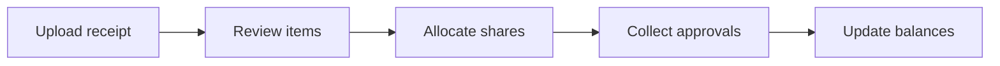
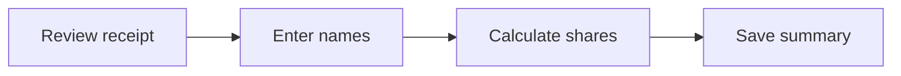

<!-- 5xl -->
# Receipt-based Shared Expense Allocation Application

Author: Yakuphan Kiris  
Neptun: JDCZNC  
Supervisor: Sári Dávid  
Project ID: 2026_SD_4

---

## Problem

**One receipt does not mean equal spending.**

- Housemates buy personal and shared products together.
- Equal splitting can charge people for products they did not buy.
- Discounts, partial repayments, and later purchases complicate tracking.

**Example:** Jacop pays 12,000 HUF for shopping with Sam and Max. Some products are shared; others belong to only one person.

Who should pay how much, and what remains unpaid next week?

---

## Target users

- **Primary:** Housemates who regularly share supermarket purchases.
- **Secondary:** Users splitting a one-off purchase with friends.

They need to:

- Check what was bought and how each share was calculated.
- Divide personal and shared items fairly.
- See debts and receivables across multiple purchases.

---

## Planned solution

**Capture → Review → Allocate → Approve → Track**

- Photograph a receipt on mobile; inspect expenses on mobile or web.
- OCR and AI suggest items, quantities, and amounts linked to receipt regions.
- Users correct missing or uncertain information before sharing.
- Application logic calculates discounts, rounding, and balances.

**AI suggests the data; users review it; application rules calculate the amounts.**

---

## Planned scope

**First usable version**

- HUF supermarket receipts from Hungary.
- Accounts, household groups, and invitation codes.
- Equal or manual allocation, including percentages, fixed amounts, and quantities.
- Approvals, correction history, refunds, confirmed repayments, and exportable summaries.
- Saved one-off receipts and personal expense history.

**Outside the first version**

- Bank integration, money transfers, and tax/accounting compliance.
- Multiple currencies, offline entry, and restaurant receipts.

---

## Initial user journey: group shopping

Jacop creates a household group; Sam and Max join by invitation code.

- Jacop pays, uploads the receipt, and corrects extraction errors.
- He splits the total equally or assigns products manually; remaining items can be shared in one action.
- Balances change only after the payer and everyone with a share approve the same version.

**Members can propose corrections. Accepted changes require fresh approvals, and previous versions remain in the history.**

---

## Initial user journey: debts and repayments

**Sam and Jacop's balance across several purchases**

| Event | Sam owes Jacop |
| --- | ---: |
| Jacop pays Sam's share of a purchase | 2,000 HUF |
| Sam repays 1,000 HUF; Jacop confirms receipt | 1,000 HUF |
| Jacop pays another 3,000 HUF share for Sam | 4,000 HUF |
| Sam later pays Jacop's 2,000 HUF share | **2,000 HUF** |

- Each account shows the same balance from its own perspective.
- Pending repayments do not reduce debts.
- Paying a debt does not count as a second personal expense.

---

## Initial user journey: one-off shopping

Jacop pays for a one-off purchase with Sam and Max, without creating a group.

- Jacop splits the total equally or assigns products manually.
- He can reopen the receipt, show friends their shares, and track his own spending.

**Sam and Max need no accounts or approvals; no account-linked debts are created.**

---

## Next steps

- Prepare wireframes for receipt correction, allocation, and approval.
- Define supported receipt layouts and a manually verified evaluation dataset.
- Compare basic OCR with structured AI: recognition, correction effort, and entry time.
- Validate calculation rules with known-result examples.
